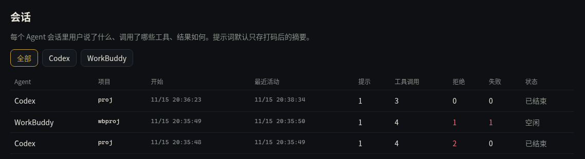
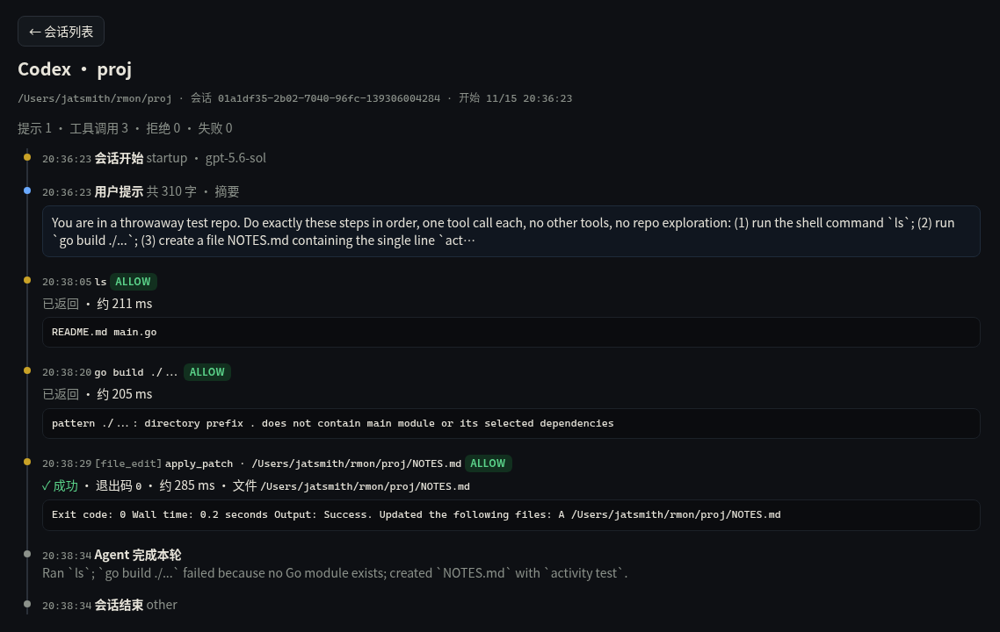

# Activity monitoring (sessions)

ReinsAARM's pre-tool hook decides whether a tool call may run. The activity
events record what happened around those decisions, so you can see what a
Codex or WorkBuddy session actually did: what the user asked, which tools ran,
what each decision was, how each call ended, and when the agent stopped.

Activity events are **observation only**. Their hook always exits 0 with no
output (Gemini gets `{}`), even when the sidecar is down, and never changes a
tool call. Blocking still happens only in `PreToolUse` / `BeforeTool`.

## What is recorded

Every event becomes a receipt in the same signed hash chain as the decisions.
New receipt types (`event_type`):

| `event_type` | Hook events | Stored in `activity` |
|---|---|---|
| `session.start` | `SessionStart` | `source` (startup / resume / clear / compact), `model` |
| `prompt.submit` | `UserPromptSubmit`, Gemini `BeforeAgent` | prompt **summary**: secrets masked, whitespace collapsed, first 240 characters; `prompt_chars` |
| `tool.result` | `PostToolUse`, `PostToolUseFailure`, Gemini `AfterTool` | `success`, `exit_code`, `interrupted`, `duration_ms` + `duration_from`, `files`, `output` (≤800 chars, line breaks kept) or `error` (≤300 chars), all masked; `result_links` for web / search tools |
| `agent.stop` | `Stop`, Gemini `AfterAgent` | last assistant message, masked, ≤2000 chars, `message_chars`; Codex: `commentary`, `trigger`, `originator` from the transcript |
| `session.end` | `SessionEnd` | `reason` |

Decision receipts (`action.decision`) now also carry `cwd`, `turn_id` (Codex)
and `tool_use_id`, and, when capture is on, `activity.args_preview` /
`activity.query` (see *Task replay*). A `tool.result` receipt points back at its decision with
`ref_seq`; the sidecar pairs them by `tool_use_id` (Codex, Claude Code,
WorkBuddy) or, when the agent sends none (Gemini), by the action digest. The
console also pairs by `tool_use_id`, so pairing survives a sidecar restart.

The new fields are omitted when empty: receipts written by older versions
still verify (`internal/ledger/testdata/pre-activity.jsonl` is checked in a
test), and new receipts chain onto old ones.
Not the other way round: a binary from before this change reports
`receipt_hash mismatch` on a chain that already holds activity receipts, so
do not roll the binary back on a state directory that has recorded them.

### Full prompts

Off by default. To store whole prompts (secrets still masked, capped at 8000
characters), add to `config.yaml` in the state directory and restart
`reinsaarm run`:

```yaml
record_full_prompts: true
```

### Masking

`internal/redact.Mask` replaces `KEY=value` secrets, private key blocks,
`sk-…`, `ghp_…` / `github_pat_…`, Slack `xox?-…`, AWS `AKIA…`, Google `AIza…`,
JWTs, `Bearer` / `Basic` credentials, URL user:password, secret query
parameters, and secret-named JSON / YAML fields. It is a pattern list, not a
guarantee: an unusual secret format can still reach a summary.

## What each agent sends

Checked on 2026-11-15.

| Agent | Events installed | Result details available | Source |
|---|---|---|---|
| Codex 0.151 | `PostToolUse`, `SessionStart`, `SessionEnd`, `UserPromptSubmit`, `Stop` | Bash: output text only, **no exit code**, so `success` stays unknown. `apply_patch`: text starting `Exit code: N`, parsed. No duration: `duration_ms` is the time between the pre and post hooks (`duration_from: hooks`, shown as "约"). `tool_use_id` pairs pre and post. | `openai/codex` `rust-v0.151.0` `codex-rs/hooks/schema/generated/*.command.input.schema.json`, `core/src/tools/context.rs` (`post_tool_use_response`); live run below |
| WorkBuddy / WorkBuddy AI | the Codex set plus `PostToolUseFailure` | Bash `rawResponse`: `exitCode`, `interrupted`, `is_error`, `error` (stderr, first 500 chars), no stdout. Write: `filePath`, `success`. `tool_use_id` (= `call_id`). `SessionStart` has no `cwd`. | WorkBuddy AI 5.9.4 bundled CLI (`convertToSdkInput`, `executePostToolUseHooks`, Bash tool `rawResponse`, `SessionHookManager`) and bundled `docs/en/cli/hooks.md` |
| Claude Code | the WorkBuddy set | Structured `tool_response` (Bash `stdout` / `stderr`), `duration_ms`, failure `error` with `Exit code N` first line | code.claude.com/docs/en/hooks |
| Gemini CLI | `AfterTool`, `SessionStart`, `SessionEnd`, `BeforeAgent`, `AfterAgent` | `tool_response.llmContent` / `returnDisplay` / `error`; no tool id | geminicli.com/docs/hooks/reference |
| CodeBuddy (IDE) | `PostToolUse`, `SessionStart`, `SessionEnd`, `UserPromptSubmit`, `Stop` | as WorkBuddy | CodeBuddy Code hooks reference bundled with WorkBuddy; the IDE itself was not checked |

Codex notes: `UserPromptSubmit` and `Stop` take no matcher, so none is
written (it would not be part of the trust hash). `SessionEnd` is written with
`timeout: 3` because Codex clamps it to 3 s and hashes the clamped value. Each
event has its own trust key (`…/hooks.json:post_tool_use:0:0`, …);
`install-hooks codex --trust` writes all of them. An untrusted activity hook
does not weaken blocking; `doctor` reports it as a note, not a failure.

## Install and check

`install-hooks codex|workbuddy|claude-code|gemini|codebuddy` now writes the
activity events next to the pre-tool hook, with the same command. A rerun
updates the command in place and adds nothing; the file is backed up first
when it changes. Other hooks in the file are kept.

`doctor` (Codex and WorkBuddy) lists the activity events found and which are
missing. The console health page has a "Codex 活动事件" item, and the WorkBuddy
item shows `活动事件 n/6`.

## Console: 会话

The 会话 page lists sessions (agent, project = last part of `cwd`, start,
last activity, prompts, tool calls, denials, failures, state). Click one for
its timeline: session start → prompt → each tool call with its decision and
result → agent stop → session end. Denied calls show the rule ids and have no
result. The decision stream and audit pages are unchanged and do not show
activity receipts.





## Task replay (任务回放)

The 会话 page groups each session into **tasks** (turns): what the user asked,
every step the agent took, what it found, what it answered, and what was
risky. It shows what ReinsAARM saw, which Codex does not show the user.

### Capture

Extra fields, all masked with `redact.Mask`, all `omitempty` (old receipts
still verify and still render; missing fields show as "未记录" / "未采集"):

| Field | Receipt | Content |
|---|---|---|
| `activity.args_preview` | `action.decision` | Tool input as indented JSON (MCP, web, read, …), ≤600 chars. Shell: the full command only when longer than the 180-char `command_preview`. Write / edit: string values cut to 160 chars ("…（共 N 字）"). |
| `activity.query` | `action.decision` | Search text from `q`, `query`, `search_query`, `pattern`, … (Codex `web_run`: `system2_search_query[].q`, `find[].pattern`). |
| `activity.result_links` | `tool.result` | Up to 8 `{url,title}` from web / search results ("Title (url)" or bare URLs). Query string, fragment and user:password are removed. |
| `activity.message_chars` | `agent.stop` | Length of the whole final answer. |
| `activity.commentary` | `agent.stop` | Codex only: up to 12 progress notes (`phase: commentary`) of this turn, ≤300 chars each. |
| `activity.trigger`, `activity.originator` | `prompt.submit`, `agent.stop` | Codex only: `turn_attribution.turn_trigger` (composer / exec / `automation_heartbeat_scheduled`) and `session_meta.originator` (Codex Desktop / codex_exec). |

Commentary, trigger and originator come from the Codex rollout transcript
(`transcript_path` in the hook payload). It is read only when the path is
absolute, ends in `.jsonl`, is a regular file and lies under
`developer_home`; only the first 64 KB and the last 4 MB (Stop) / 1 MB
(prompt) are read, so a 200 MB rollout costs little.

Limits, in `config.yaml` of the state directory (restart `reinsaarm run`):

```yaml
capture:
  off: false          # true: no previews, links or transcript; output 400, answer 300 (the old sizes)
  args_preview: 600   # 0 turns args previews off
  output_preview: 800
  final_message: 2000
  result_links: true
  transcript: true    # Codex transcript: commentary, trigger, originator
```

### Turns

A turn is the run of receipts with one `turn_id` (Codex), else from one prompt
to the next. `session.start` belongs to the turn after it. Status: `done`
(Stop seen), `running`, `no_stop` (a later turn or session end came without
Stop), `decisions_only` (only pre-tool receipts: activity hooks were not
installed). A running turn with no event for 30 minutes is `stale` and the
session shows "30 分钟无活动".

Steps get a category: `web` (web_fetch, or MCP tools named search / web /
fetch / browse …), `mcp`, `read` (file_read or a read-only shell command such
as `cat`, `ls`, `rg`), `write`, `shell`, `other`. Gaps of 20 s or more without
hook events are shown as model thinking (between steps) or composing the
answer (last step → Stop); `?gap=N` changes the threshold.

Source: `automation` (trigger `automation*` or a `<heartbeat>` prompt),
`desktop` / `cli` / `ide` from the originator (and Codex `turn_trigger=exec`),
else a client fallback: Claude Code and Gemini default to `cli`; WorkBuddy has
no originator, so the console uses the workspace path (a dated `WorkBuddy AI/`
task folder or a `/~:` virtual project path means desktop) or a placeholder
model (`default-model`, seen on CLI `-p`) and otherwise `unknown`. It does not
label every WorkBuddy session as desktop. Timeline steps are shown as session
start → prompt → tools → stop even when `UserPromptSubmit` was written (and
sometimes timestamped) before `SessionStart`; receipt `seq` is unchanged.

### Risk flags

| Code | Label | When |
|---|---|---|
| `deny` | 拒绝 | enforced DENY / DEFER |
| `fail` | 失败 | `success:false`, a non-zero exit code, or — when the agent sends no exit code (Codex Bash) — an output with a Traceback, `XxxError:` or panic ("按输出判断") |
| `outside_read` / `outside_write` / `outside_path` | 项目外读取 / 写入 / 路径 | a path outside the turn's `cwd` |
| `no_rule_mcp` | 无规则放行 MCP | MCP call allowed only by `R-DEFAULT-ALLOW` |
| `credential` | 命中凭证路径 | rule `R-CRED-PATH` matched |
| `egress` | 出网 | a non-web step with hosts |
| `untrusted_then_sensitive` | 不可信输入后敏感操作 | a write, changing shell command or egress after a web / search result in the same turn |

### API

While the console is bound only to loopback, a request from a loopback address (`127.0.0.1`, the rest of `127.0.0.0/8`, or `::1`) does not need a token. Any other client still needs the console token. There is no login page.

- `GET /api/sessions` — each session adds `turns`, `status` (running /
  turn_done / ended / idle / decisions_only), `model`, `source`,
  `source_label`, `latest_title`, `latest_one_liner`, `risks`, `risky`.
- `GET /api/sessions/{key}` — `{session, items, turns, policy}`;
  `GET /api/sessions/{key}/turns` — `{turns}`. A turn has `index`, `id`,
  `start`, `end`, `duration_ms`, `status`, `stale`, `prompt`, `title`,
  `final`, `final_chars`, `commentary`, `source`, `source_label`, `trigger`,
  `counts`, `denied`, `failed`, `one_liner`, `risks`, `gaps`, `think_ms`,
  `seq_from`, `seq_to`, `untrusted`, `sensitive_after`, `has_previews`,
  `coverage` (what the hooks cannot see), `steps`, `live`, `elapsed_ms`.
  A step is a timeline item plus `index`, `category`, `label`, `server`,
  `tool_name`, `query`, `paths[{path,outside}]`, `hosts`, `links`, `no_rule`,
  `denied`, `failed`, `fail_source`, `fail_hint`, `credential`, `untrusted`,
  `sensitive`, `after_untrusted`, `running`, `duration_ms`.
  `policy` is `{mcp_rules, network_mode, confine_writes}`.
- `GET /api/sessions/{key}/report?turn=N&format=md|json&tz=Asia/Singapore` —
  the task report as a download (Markdown, or JSON with schema
  `reinsaarm.task_report.v1`), including the chain check.
- `GET /api/receipts?from=A&to=B` — every receipt type in a seq range (the
  "查看审计回执" link); without `from`/`to` the decision stream is unchanged.

### Console

List: agent filter, 有风险, 今天 / 近 7 天 / 全部时间, one row per session
with the latest task title, one-liner and risk chips. Detail: one card per
task with the prompt, a one-line summary, a "Agent 说了什么 / ReinsAARM 看到了什么"
strip (left: derived from the final answer and commentary), a time bar,
the steps (expanded when running, failed, denied, outside the project, after
untrusted input, or the first web result), the final answer, a 未覆盖 box,
and export. Click a step for the side drawer with the full receipt. Deep
links: `#/sessions/<key>/<turn>/<seq>`, `#/audit/<from>-<to>`,
`#/policy/new-mcp-rule` (from "为这类 MCP 新建规则": a YAML snippet to copy that
can simulate it; it never writes the profile).

## Live check (macOS, 2026-11-15)

Throwaway project and separate state directory (`~/rmon`), separate sidecar
and console; the user's real `~/.codex/config.toml` and WorkBuddy settings
were not changed.

- A real `codex exec` (Codex 0.151.0) in the throwaway repo, with hook and
  project trust passed as `-c hooks.state={…}` / `-c projects={…}` overrides
  instead of writing `config.toml`. Codex fired `SessionStart`,
  `UserPromptSubmit`, three `PreToolUse` / `PostToolUse` pairs (`ls`,
  `go build ./...`, `apply_patch`), `Stop`, and `SessionEnd`; every result was
  paired with its decision by `tool_use_id`, and the chain verified.
- WorkBuddy-shaped and Codex-shaped payloads (including denied calls) fed to
  the installed hook command: allow / deny output unchanged, activity
  receipts written, chain verified.
- A WorkBuddy desktop session driving the hooks was **not** run (its bundled
  CLI needs a separate `/login`).
